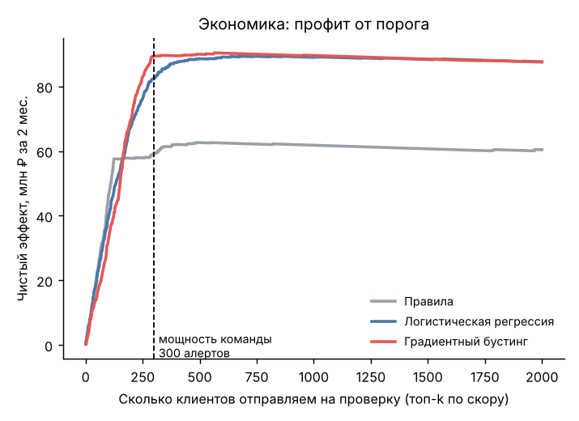
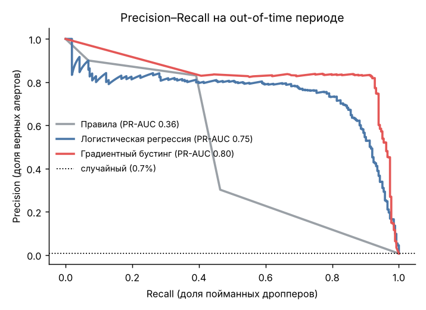
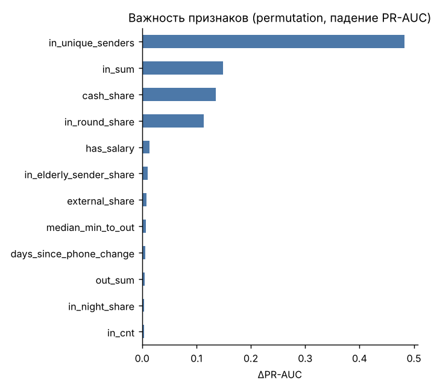
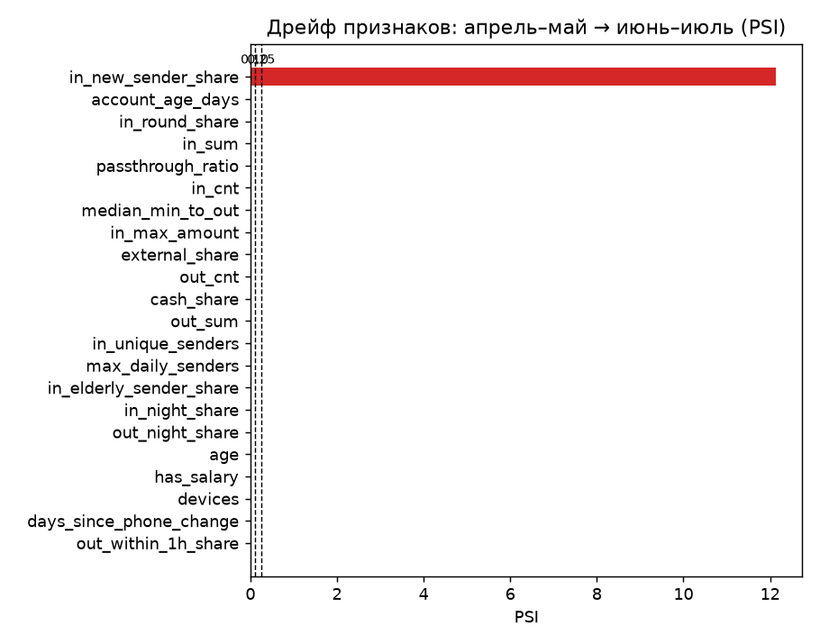

# DropHunter

[](https://github.com/antonshkelll/drophunter-antifraud/actions/workflows/ci.yml)  

Модель, которая ищет дропперов: счета, через которые мошенники выводят деньги жертв. Признаки собираются на SQL, модель построена на градиентном бустинге, а порог выбирается по деньгам с учётом того, сколько алертов успевает разобрать команда.

<p align="center"></p>

## Контекст

По данным Банка России, во II квартале 2026 года банки отразили 17,5 млн попыток хищений, но мошенники всё равно провели 458,7 тыс. операций примерно на 7,4 млрд ₽ ([Profile](https://profile.ru/?p=1887685)). Без дропперов украденное не обналичить. С 2024 года банк обязан вернуть клиенту деньги, если перевёл их на счёт из базы ФинЦЕРТ, а с 2025 года за дропперство есть уголовная ответственность. Число выявленных дроп-карт в 2026 году, по оценкам, может вырасти вдвое ([Финансы Mail](https://finance.mail.ru/article/chislo-vyiyavlennyih-kart-dropov-v-2026-godu-mozhet-vyirasti-vdvoe-69195108/)).

Для банка ошибка в обе стороны стоит денег: пропущенный дроппер означает возврат клиенту, а ложная блокировка приводит к звонку в поддержку и риску оттока.

## Постановка

Раз в два месяца модель оценивает всех клиентов с входящими переводами, и топ отправляется аналитикам на проверку.

- Объект: клиент за период. Цель: клиент был подтверждённым дроппером в этом периоде.
- Валидация out-of-time: обучение на апреле–мае, тест на июне–июле. Дропперы во втором периоде в основном новые, как и в жизни.
- Команда разбирает 300 алертов за период.

```
Чистый эффект = предотвращённый ущерб − ложные блокировки × 2 100 ₽ − проверки × 150 ₽
                 (Recall@k)              (Precision@k)
```

При доле дропперов 0,6% ROC-AUC у любой разумной модели близок к единице и мало что говорит, поэтому основные метрики здесь PR-AUC, Precision/Recall@300 и рубли.

## Данные

Реальные транзакции составляют банковскую тайну, поэтому [генератор](src/generate_data.py) создаёт синтетику по паттернам из открытых материалов ЦБ и банков: 40 000 клиентов, ~1,57 млн переводов и ~245 тыс. снятий наличных за 120 дней.

Чтобы задача не была игрушечной:

- дропперы двух типов: «простые» (быстрый вывод, круглые суммы) и «продвинутые» (держат деньги днями, выводят часть);
- есть клиенты, похожие на дропперов, но честные: самозанятые, P2P-трейдеры, студенты с переводами от родителей, продажи с рук;
- ~15% дропперов так и не подтверждаются и в данных выглядят обычными клиентами (шум в разметке).

Объём мошенничества завышен, чтобы модели было на чём учиться, поэтому абсолютные суммы в рублях условны и смотреть стоит на сравнение моделей между собой.

## Признаки

Все признаки считаются одним запросом в DuckDB: [`sql/features.sql`](sql/features.sql). Порядок строк зафиксирован, и бустинг обучается без случайной внутренней валидации, поэтому результаты воспроизводятся до последнего знака. Скорость вывода денег («через сколько минут после входящего перевода было ближайшее списание») считается через `ASOF JOIN`. Запрос покрыт тестом на маленьком примере, где значения посчитаны вручную.

| Группа | Признаки |
|---|---|
| Профиль | возраст, стаж счёта, дни с последней смены телефона, число устройств, зарплатный клиент |
| Входящие | количество, сумма, уникальные отправители, доля новых отправителей, доля круглых сумм, ночные, отправители 55+, пик отправителей за день |
| Исходящие | сумма, доля наличных, доля во внешние банки, ночные |
| Транзит | pass-through (вывод / приход), медиана минут до вывода, доля вывода в течение часа |

## Результаты

Out-of-time тест: 39 963 клиента, 263 дроппера.

| Модель | PR-AUC | Precision@300 | Recall@300 | Чистый эффект @300 |
|---|---:|---:|---:|---:|
| Правила (новый телефон или транзит) | 0,355 | 0,39 | 0,44 | 61,1 млн ₽ |
| Логистическая регрессия | 0,747 | 0,71 | 0,81 | 82,3 млн ₽ |
| Градиентный бустинг | 0,808 | 0,81 | 0,92 | 89,2 млн ₽ |

- Бустинг даёт на 46% больше чистого эффекта, чем правила, при той же нагрузке на команду. Доля верных алертов растёт с 39% до 81%.
- Команда разбирает 300 алертов, а кривая прибыли выходит на плато примерно от 340 до 680 алертов. Расширение проверки до ~400 добавило бы около 1,4 млн ₽, дальнейшее почти ничего. Небольшое расширение команды или автоматизация разбора оправданы, кратное расширение нет.
- Хуже всего ловятся «продвинутые» дропперы: recall 0,88 против 0,96 у простых.
- Среди 300 алертов 58 ложных: 48 обычных клиентов и 10 студентов. Таким клиентам лучше показать мягкий сценарий («подтвердите операцию») вместо блокировки.

<p align="center"> </p>

Самые важные признаки: число уникальных отправителей, сумма входящих, доля вывода наличными и доля круглых сумм. На синтетике это ожидаемо, потому что генератор построен на этих паттернах. Модель нашла их сама и правильно расставила по весу; на реальных данных этот же разбор покажет, какие признаки работают на самом деле.

## Мониторинг дрейфа

[`src/monitoring.py`](src/monitoring.py) считает PSI каждого признака между периодом обучения (апрель–май) и периодом скоринга (июнь–июль), до того, как придёт разметка. Пороги: < 0,10 стабильно, 0,10–0,25 заметный сдвиг, > 0,25 сильный дрейф.

<p align="center"></p>

21 признак из 22 стабилен (PSI < 0,01). У `in_new_sender_share` (доля переводов от новых отправителей) PSI 12,1. Причина в конструкции признака, а не в адаптации мошенников: в периоде обучения у всех клиентов он равен 1,0, потому что истории переводов до 1 апреля в данных нет и любой отправитель считается «новым». Модель учится на константе, а на скоринге признак уже работает. Чтобы это исправить, нужно считать «знакомых» отправителей по окну истории перед каждым периодом (например, 90 дней) и генерировать данные с запасом истории. Мониторинг поймал это расхождение обучения и прода раньше, чем пришла разметка.

## Что дальше

1. Лестница реакций вместо бинарной блокировки. При низком скоре ничего не делать, при среднем отправить push и включить период охлаждения, при высоком отдать на ручную проверку и приостановить операцию по 161-ФЗ.
2. A/B-тест этой лестницы. Основная метрика: потери от мошенничества на 1 000 клиентов. Guardrails: доля успешных переводов, обращения в поддержку, NPS.
3. Мониторинг. PSI признаков уже считается (см. выше); дальше нужны precision на свежих подтверждениях раз в неделю и окно истории для `in_new_sender_share`.
4. Графовые признаки. Цепочки «дроппер → дроппер» видны в данных, но в модель пока не заложены.

## Запуск

Нужен Python 3.10+.

macOS / Linux:

```bash
git clone https://github.com/antonshkelll/drophunter-antifraud.git
cd drophunter-antifraud
python3 -m venv .venv && source .venv/bin/activate
pip install -r requirements.txt
python src/generate_data.py   # ~5 сек, данные в data/
python src/train.py           # ~15 сек, метрики и графики в reports/
pytest -q
```

Windows (PowerShell):

```powershell
git clone https://github.com/antonshkelll/drophunter-antifraud.git
cd drophunter-antifraud
py -m venv .venv; .venv\Scripts\Activate.ps1
pip install -r requirements.txt
python src/generate_data.py
python src/train.py
```

Бизнес-допущения (стоимость проверки и ложной блокировки, мощность команды) заданы константами в начале [`src/train.py`](src/train.py).

## Ограничения

- Данные синтетические: проект показывает подход, качество на данных реального банка он не измеряет.
- В жизни разметка приходит с задержкой (жалоба жертвы через дни или недели), и в проде это нужно учитывать.
- Стоимость ложной блокировки (2 100 ₽) взята как допущение, и обсуждать с бизнесом нужно в первую очередь её.

## Стек

Python · DuckDB (CTE, оконные функции, ASOF JOIN) · pandas · scikit-learn · matplotlib

## Связанные проекты

- [Экономика быстрого платежа](https://github.com/antonshkelll/sbp-economics): 37% похищенного во II кв. 2026 ушло через СБП ([калькулятор](https://sbp.antonshkel.ru))
- [Uplift](https://github.com/antonshkelll/uplift-targeting): causal ML на реальном эксперименте

Все проекты собраны в [профиле](https://github.com/antonshkelll).
